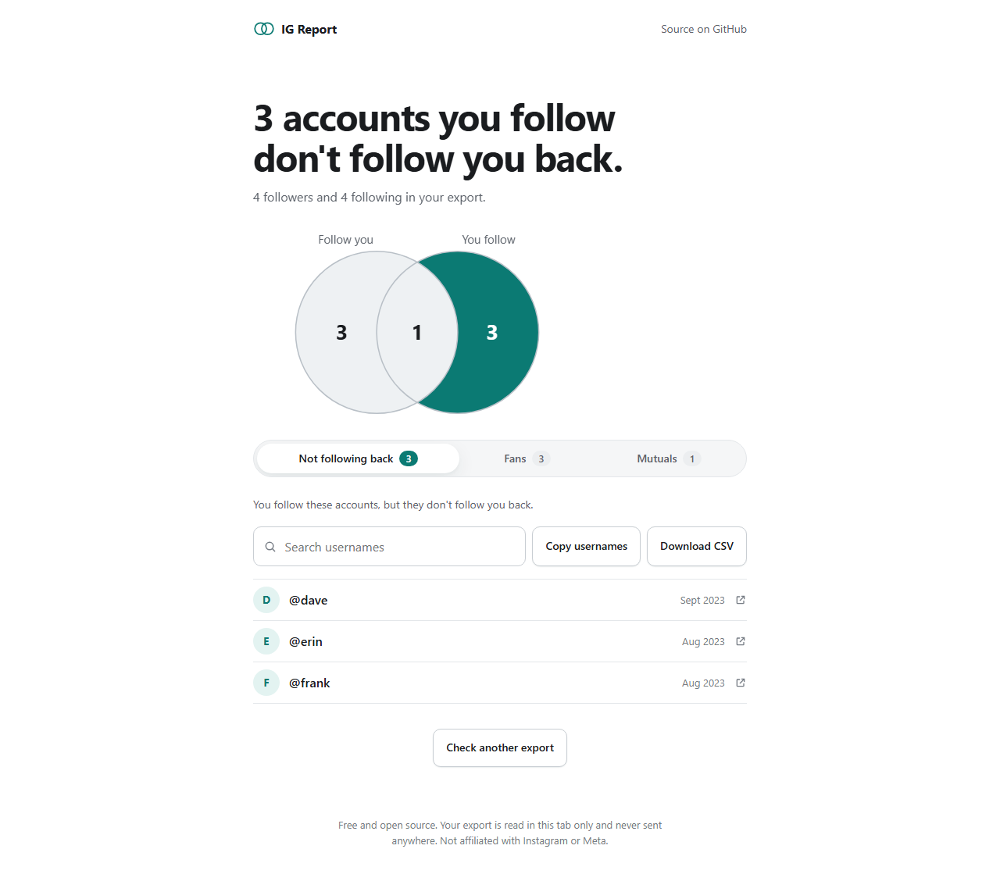

# IG Report

See who doesn't follow you back on Instagram, using your own data export. Everything runs in your browser and nothing is uploaded.

**Use it:** https://ridwanahmed06.github.io/ig-report



## What it shows

- **Not following back**: accounts you follow that don't follow you
- **Fans**: accounts that follow you that you don't follow back
- **Mutuals**: accounts where you follow each other

Each list can be searched, copied as usernames or downloaded as a CSV. Every name links to its Instagram profile.

## How to use it

1. Open [Download your information](https://accountscenter.instagram.com/info_and_permissions/dyi/) in Instagram's Accounts Center.
2. Choose **Download or transfer information**, pick your account, then **Some of your information**.
3. Tick only **Followers and following**, then choose **Download to device**.
4. Set the date range to **All time** and the format to **JSON**.
5. When Instagram emails you, download the .zip and drop it on the page. You don't need to unzip it.

You can also select `followers_1.json` and `following.json` on their own. HTML exports work too.

## Why an export and not just a username?

Instagram has no public API for follower lists, browsers block websites from reading instagram.com, and private accounts are hidden anyway. Tools that work from a username alone either log into an Instagram account on a server, which breaks Instagram's rules and gets accounts blocked, or ask for your password. The export is the safe route. It is your own data and comes straight from Instagram.

## Privacy

- The page has no backend, no analytics and no cookies.
- Your file is read in the browser tab and never leaves your device. The page's Content Security Policy sets `connect-src 'none'`, so the browser itself blocks any network request from the page.
- Only the two follower files are unzipped. Everything else in the export is ignored.

## Run it locally

No install needed. Any static file server works:

```
python -m http.server 8000 -d src
```

Then open http://localhost:8000.

## Tests

```
npm test                    # unit tests (Node's built-in runner, zero dependencies)
npm run coverage            # same, with a coverage table
python tools/test-e2e.py    # browser test with Playwright (pip install playwright && playwright install chromium)
```

## How it works

| File | Job |
|---|---|
| `src/scripts/zip.js` | Small zip reader. It reads the zip's file index from the end of the file and unpacks only the entries it needs with the browser's `DecompressionStream`, so multi-gigabyte exports are fine. Supports ZIP64. |
| `src/scripts/parse.js` | Finds the followers/following files and pulls out usernames. It handles Instagram's older and newer JSON shapes plus the HTML format. |
| `src/scripts/compare.js` | Case-insensitive comparison into the three lists. |
| `src/scripts/csv.js` | CSV export, with protection against spreadsheet formula injection. |
| `src/scripts/load.js` | Turns dropped files (a zip or loose files) into lists. |
| `src/scripts/main.js` | Page wiring. |

Deployed to GitHub Pages by `.github/workflows/pages.yml`, which runs the tests and then publishes `src/`.

## Decisions log

- **2026-11-25**: Data comes from the official export, not a username lookup. A lookup is impossible without breaking Instagram's rules.
- **2026-11-25**: Zero dependencies, including a hand-written zip reader (~150 lines). It keeps the page auditable and lets it read just two files out of a possibly huge export.
- **2026-11-25**: Teal accent and a Venn-diagram mark, with no Instagram logo or colours, so the tool never looks official.
- **2026-11-25**: Sample-data rows are never linked, because a made-up username could belong to a real person.

## License

MIT. Not affiliated with Instagram or Meta.
